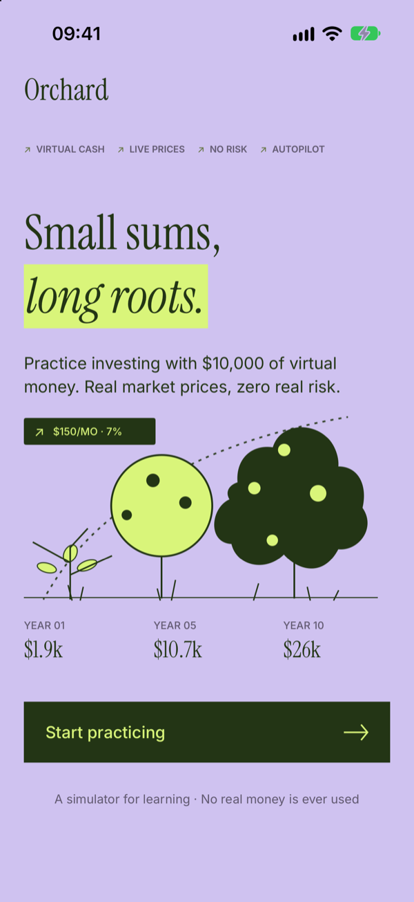
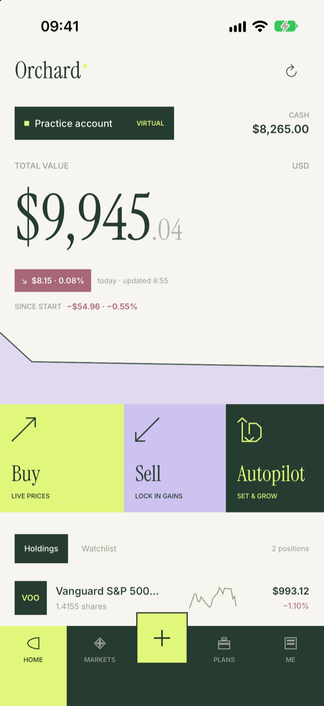
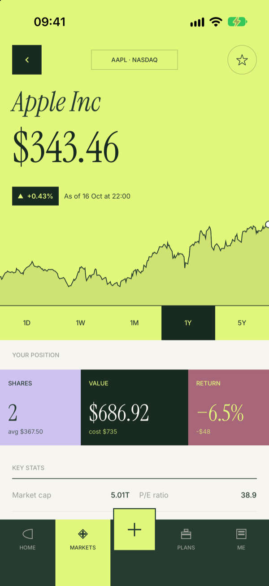
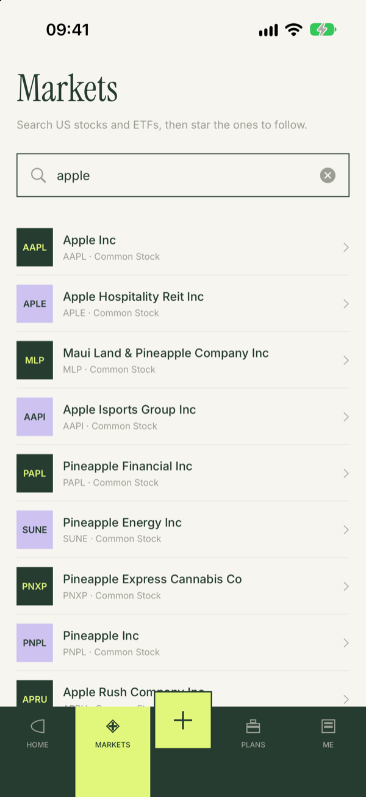
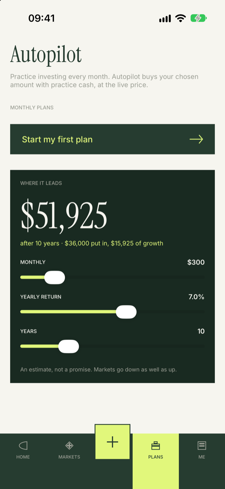
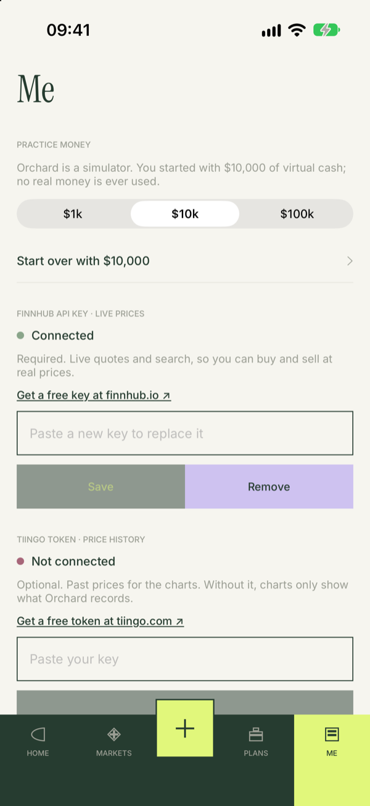

# Orchard

**Small sums, long roots.** Orchard est un simulateur d'investissement pour iPhone. On y apprend à investir en bourse avec de l'argent virtuel, aux vrais prix du marché, sans aucun risque.

<p align="center">
  
  
  
</p>
<p align="center">
  
  
  
</p>

## Fonctionnalités

- **Compte d'entraînement** : on démarre avec 1 000 $, 10 000 $ ou 100 000 $ virtuels. Aucun argent réel n'est jamais utilisé.
- **Achats et ventes au prix réel** : chaque ordre est exécuté instantanément au dernier cours. On peut passer l'ordre en dollars ou en nombre d'actions, et les fractions d'action sont acceptées.
- **Tableau de bord** : valeur totale, liquidités, variation du jour, performance depuis le début et courbe de la valeur du portefeuille.
- **Fiche action** : cours en direct, courbe sur 1J / 1S / 1M / 1A / 5A, votre position (prix moyen, valeur, rendement), indicateurs clés et historique de vos ordres.
- **Markets** : recherche des actions et ETF américains, et watchlist.
- **Autopilot** : achat automatique d'un montant fixe chaque mois avec l'argent virtuel, pour s'exercer à l'investissement programmé. Un rappel est envoyé le jour J.
- **Projection** : ce que donnerait un versement mensuel régulier à un rendement donné (intérêts composés).
- **Actualisation automatique** des cours toutes les minutes tant que l'app est ouverte.

## Sources de données

Orchard s'appuie sur deux services gratuits. Chaque utilisateur crée **ses propres clés** et les saisit dans l'app, à l'écran « Connect prices » au premier lancement ou plus tard dans l'onglet **Me**. Les clés sont vérifiées auprès du service, puis stockées dans le **trousseau** de l'appareil. Aucune clé n'est intégrée au code.

| Service | Rôle | Obligatoire | Offre gratuite |
|---|---|---|---|
| [Finnhub](https://finnhub.io/register) | Cours en direct, recherche, profil et indicateurs | Oui | ~60 requêtes/min, actions US |
| [Tiingo](https://www.tiingo.com/account/api/token) | Historique quotidien pour les courbes (5 ans) | Non | 50 requêtes/h, 1 000/jour |

Sans clé Tiingo, les courbes n'affichent que les prix enregistrés par l'app elle-même. L'historique est chargé une seule fois par action et par jour, pour respecter les limites de l'offre gratuite.

> Les offres gratuites de Finnhub et Tiingo sont réservées à un usage personnel. Seules les actions et ETF américains sont couverts.

## Prérequis

- Xcode 27 ou plus récent
- iOS 27 / macOS 27
- Une clé API Finnhub (gratuite), et en option un token Tiingo

## Lancer le projet

```bash
git clone https://github.com/davidamzou/Orchard.git
cd Orchard
open Orchard.xcodeproj
```

Choisissez le schéma **Orchard** et un simulateur iPhone, puis lancez (⌘R). Au premier lancement, collez vos clés sur l'écran « Connect prices ».

## Tests

Les tests unitaires couvrent notamment le calcul des positions (prix moyen, plus-values réalisées), les liquidités, les dates d'Autopilot, la courbe du portefeuille et les projections.

```bash
xcodebuild test -project Orchard.xcodeproj -scheme Orchard -destination 'platform=macOS' -only-testing:OrchardTests
```

## Architecture

SwiftUI, SwiftData et Swift Charts, sans aucune dépendance externe.

| Fichier | Rôle |
|---|---|
| `OrchardApp.swift`, `ContentView.swift` | Point d'entrée, onboarding puis connexion des clés |
| `Models.swift` | Modèles SwiftData (`Stock`, `Trade`, `PricePoint`, `DailyClose`, `AutopilotPlan`), calcul des positions et de la valeur du portefeuille |
| `MarketData.swift` | Rafraîchissement des cours, historique, exécution d'Autopilot |
| `FinnhubClient.swift`, `TiingoClient.swift` | Clients des deux API |
| `Keychain.swift` | Stockage des clés dans le trousseau |
| `WelcomeView.swift`, `DashboardView.swift`, `StockDetailView.swift`, `MarketsView.swift`, `PlansView.swift`, `SettingsView.swift` | Écrans |
| `TradeSheet.swift`, `APIKeysView.swift` | Passage d'ordre, saisie des clés |
| `Theme.swift`, `Components.swift`, `Formatting.swift` | Couleurs, polices, composants partagés, formats |

Toutes les données (ordres, plans, historique) restent sur l'appareil. Seuls les tickers consultés sont envoyés à Finnhub et Tiingo.

## Design et crédits

- Maquettes conçues dans Figma, reproduites en SwiftUI.
- Polices [Instrument Serif](https://fonts.google.com/specimen/Instrument+Serif) et [Inter](https://fonts.google.com/specimen/Inter), sous licence SIL Open Font License (voir `Orchard/Fonts/`).

## Avertissement

Orchard est un outil d'apprentissage. Les résultats obtenus en simulation ne préjugent pas des rendements réels, et rien dans l'application ne constitue un conseil en investissement.
